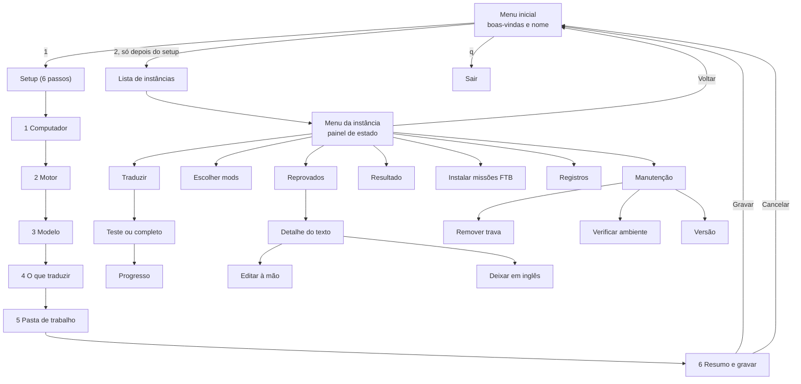
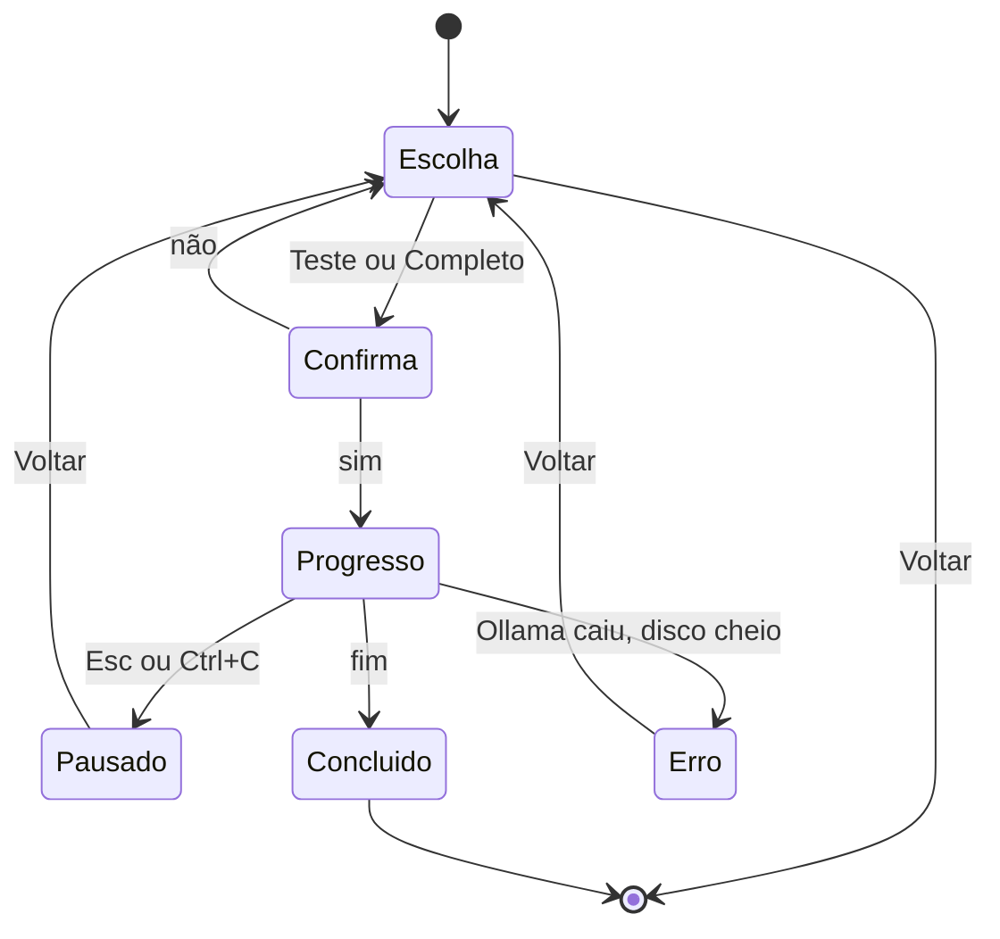
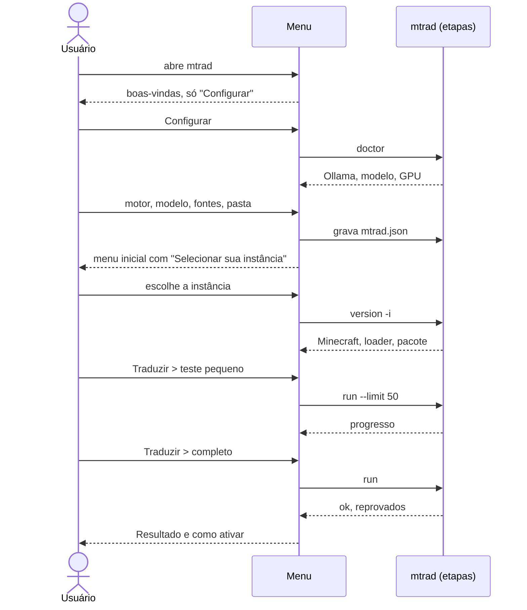

# mtrad: interface no terminal (desenho detalhado)

Versão do desenho: 31/10/2026, revisão 3 (menu inicial simples, setup em passos, controle por setas; **ligada ao `mtrad` de verdade**).
Estado: **integrada**. A interface (`internal/ui`) fala com o `Backend`; `mtrad ui` (ou `mtrad` sem argumentos num terminal) usa o backend de verdade, `cmd/mtrad/uibackend.go`, que chama as etapas; `mtrad ui --demo` usa dados falsos. A seção 10 diz o que foi feito e o que fica para depois; a seção 12 descreve a integração.

Convenções deste arquivo: **(mock)** = já existe no mock com setas; **(proposto)** = ainda só desenhado aqui; **(depende)** = precisa de algo que o `mtrad` ainda não tem.

---

## 1. Resumo: como é o aplicativo

**O que é.** O `mtrad` traduz mods e modpacks de Minecraft para português do Brasil, de graça, com um modelo de IA que roda no seu próprio computador (hoje o `translategemma:4b` no Ollama, na RX 580 via Vulkan). Ele lê os textos de dentro dos mods, traduz, confere se nada quebrou e monta um pacote de recursos (`mtrad-pt_br.zip`) para o Prism Launcher.

**Como é por dentro.** Um programa só (binário estático em Go, sem dependências), feito de etapas que conversam por arquivos na pasta de trabalho: `scan`, `extract`, `patchouli`, `ftbq`, `diff`, `protect`, `route`, `translate`, `validate`, `pack`, `install`. O comando `run` roda todas em sequência. A tradução pode ser interrompida e retomada: o que já foi traduzido fica guardado e não é refeito. Cada execução deixa um registro em `work/logs/`.

**Como a interface entra.** Hoje tudo é por comandos (`mtrad run -i ... -c ... -w ...`). A interface é um **menu no terminal, controlado por setas**, que faz as mesmas coisas sem decorar comandos, e mostra o comando equivalente depois de cada ação.

**Como é a interface, em uma tela.**

1. Abre com boas-vindas e o nome do programa. Só há duas opções: **Configurar (setup)** e **Selecionar sua instância** (esta só aparece depois do setup).
2. O **setup** tem 6 passos, um por tela: conferir o computador, escolher motor, modelo, o que traduzir, pasta de trabalho, e gravar.
3. **Selecionar sua instância** lista as instâncias do Prism e abre o **menu da instância**, com o estado no topo (motor, textos traduzidos, reprovados) e 7 telas: Traduzir, Escolher mods, Reprovados, Resultado, Instalar missões do FTB Quests, Registros e Manutenção.
4. Teclas: **↑ ↓** movem, **Enter** escolhe, **Espaço** marca, **Esc** volta uma tela.

**O que a interface nunca faz.** Apagar a pasta de trabalho ou o cache; instalar algo no sistema sem confirmação; guardar senha ou chave de API; sobrescrever arquivo do jogo sem confirmar.

---

## 2. Mapa geral



`Esc` volta uma tela em qualquer ponto; no menu inicial não há para onde voltar.

---

## 3. Estado que a interface guarda

| Dado | Origem na versão real | Quando muda |
|---|---|---|
| `setup feito` | existe um `mtrad.json` válido e o motor escolhido responde | ao gravar o setup (passo 6) |
| motor, modelo, fontes, pasta de trabalho | `mtrad.json` | passos 2 a 5 do setup |
| instância escolhida | lembrada em `mtrad.json` (campo da interface, sem segredos) **(proposto)** | ao escolher na lista |
| mods que ficam em inglês | `skip_mods` no `mtrad.json` | na tela Escolher mods |
| contagens (traduzidos, reprovados, faltando) | arquivos em `work/` (`translated.jsonl`, `failed.jsonl`, `*.done.json`) | a cada execução |
| Ollama no ar, modelo na GPU | consulta a `127.0.0.1:11434` e `/api/ps` | ao abrir o menu da instância e a cada ação |
| correções à mão | `work/review.jsonl` **(depende: item 16 da seção 31)** | tela de reprovados |

Regra de visibilidade: a opção **Selecionar sua instância** só existe se `setup feito`. Sem setup, escolher a opção 2 à força mostra "faça a configuração antes".

---

## 4. Teclas

| Tecla | Faz | Onde |
|---|---|---|
| ↑ ↓ | move a seleção (dá a volta no fim da lista) | todas as listas **(mock)** |
| Enter | escolhe o item; nos passos do setup, escolhe e segue | todas **(mock)** |
| Espaço | marca/desmarca | passo 4 do setup, tela de mods **(mock)** |
| Esc ou Backspace | volta uma tela; no progresso, pausa | todas **(mock)** |
| `r` | marca os mods repetitivos | tela de mods **(mock)** |
| PgUp / PgDn, Home / End | rola listas longas (127 mods, 196 reprovados) | mods e reprovados **(proposto)** |
| `/` | filtra a lista pelo que for digitado | mods e reprovados **(proposto)** |
| `q` | sai (no menu inicial) | menu inicial **(proposto)** |
| Ctrl+C | pausa a tradução; fora dela, sai | **(proposto)** |
| `?` | mostra a ajuda de teclas da tela | todas **(proposto)** |

A última linha de cada tela mostra só as teclas que valem ali.

Fora de um terminal interativo (script, pipe, `NO_COLOR`), o `mtrad` não abre o menu e os comandos de hoje continuam iguais.

---

## 5. Telas, uma a uma

Largura de referência: 66 colunas. Seleção marcada com `❯`.

### 5.1 Menu inicial

Objetivo: dar boas-vindas e levar ao primeiro passo certo.

Sem setup:

```
  ╔══════════════════════════════════════════════════════════╗
  ║                        m t r a d                         ║
  ║                                                          ║
  ║  Tradutor de mods de Minecraft para português do Brasil  ║
  ║                 versão 0.10 (protótipo)                  ║
  ╚══════════════════════════════════════════════════════════╝

  Bem-vindo!
  Modo demonstração: nada é executado de verdade.

❯ Configurar (setup)
  Sair

  Primeira vez por aqui? Comece pela configuração: leva poucos passos.

  ↑↓ mover · Enter escolher
```

Com setup feito:

```
❯ Configurar (setup)
  Selecionar sua instância
  Sair
```

- "Configurar" também serve para refazer o setup (começa com os valores atuais).
- O texto "Modo demonstração" só aparece no protótipo; na versão real some.
- Entrada: nenhuma. Saídas: Setup, Lista de instâncias, fim do programa.

### 5.2 Setup: regras comuns dos 6 passos

- Cada passo é uma tela com o cabeçalho `Passo n de 6  Título` entre duas linhas.
- **Enter** confirma o item e segue; **Esc** volta ao passo anterior (no passo 1, volta ao menu inicial sem gravar nada).
- Nada é gravado até o passo 6. Cancelar em qualquer ponto não deixa rastro.
- Os valores já escolhidos aparecem marcados (`◉`/`[x]`), para refazer o setup sem digitar de novo.

### 5.3 Setup, passo 1: Conferir o computador

```
────────────────────────────────────────────────────────────────
 Passo 1 de 6  Conferir o computador
────────────────────────────────────────────────────────────────

  ✓ Ollama responde em 127.0.0.1:11434        versão 0.12
  ✓ Modelo translategemma:4b instalado        3,3 GB
  ✓ Modelo está na GPU                        100% GPU, 4,1 de 8 GB de VRAM
  ✓ Pasta de trabalho gravável                work-real
  ✓ Espaço livre em disco                     41 GB
  ✓ ollama-vulkan instalado                   pacote do Arch

  ✓ tudo certo com o Ollama, o modelo e a placa de vídeo.
  equivale a: mtrad doctor

❯ Continuar
```

Quando algo falta (**proposto**), no lugar da linha de "tudo certo":

```
  ✗ Ollama responde em 127.0.0.1:11434        não respondeu
  ✗ ollama-vulkan instalado                   não encontrado

  ! falta algo. Para instalar no Arch (nada é instalado sem você confirmar):
    sudo pacman -S ollama ollama-vulkan
    sudo systemctl enable --now ollama
    ollama pull translategemma:4b

❯ Instalar agora (pede confirmação, a senha é do sudo)
  Continuar assim mesmo
  Verificar de novo
```

- "Instalar agora" mostra o comando exato e o tamanho do download e só roda depois de um "sim". O `mtrad` nunca vê a senha: quem pede é o `sudo`.
- "Continuar assim mesmo" deixa seguir, mas o menu da instância mostrará "Ollama parado" em vermelho.
- Equivale a: `mtrad doctor`. **(depende)** A parte de instalar é a ideia `mtrad setup` (seção 31).

### 5.4 Setup, passo 2: Motor

```
 Passo 2 de 6  Escolher o motor de tradução

  ◉ ollama   modelo local pelo Ollama (grátis, na sua placa) · recomendado
  ○ llama    modelo local pelo llama.cpp (mais manual)
  ○ gemini   API do Google (grátis com limite; precisa de chave)
  ○ libre    LibreTranslate local (qualidade menor)
  ○ ct2      tradutor neural em CPU (lento, precisa de Python)
```

- ↑↓ move; Enter escolhe e vai ao passo 3. A opção atual vem selecionada.
- Trocar de motor reinicia a escolha do modelo.
- `gemini`: avisa no passo 3 que é preciso `GEMINI_API_KEY` no ambiente; a chave nunca é pedida nem gravada pela interface.
- `ct2`: grava `tools/ct2worker.py` (embutido no binário) na pasta atual, se não existir, e avisa que precisa de `pip install ctranslate2 sentencepiece transformers`.

### 5.5 Setup, passo 3: Modelo

Motor `ollama`:

```
 Passo 3 de 6  Escolher o modelo

  ◉ translategemma:4b   instalado · recomendado (3,3 GB)
  ○ gemma3:12b          instalado
  ○ qwen3:8b            instalado
```

- A lista vem de `ollama list`. Se o modelo escolhido não estiver instalado, a tela mostra `ollama pull <nome>` e oferece baixar com confirmação e tamanho.
- Motor `gemini`: lista modelos de exemplo e o aviso da chave. Motores `llama`, `libre`, `ct2`: "usa o modelo do próprio serviço" e um único item Continuar.
- Equivale a: `--model` do `mtrad init`.

### 5.6 Setup, passo 4: O que traduzir

```
 Passo 4 de 6  O que traduzir

  Espaço marca e desmarca; escolha Continuar para seguir.

  [x] lang        nomes, itens e dicas dos mods
  [x] patchouli   livros de guia dentro do jogo
  [x] ftbq        missões do FTB Quests
❯ Continuar
```

- Espaço (ou Enter) alterna a fonte sob o cursor. Pelo menos uma precisa ficar marcada: se o usuário desmarcar a última, ela volta marcada e aparece "ao menos uma fonte precisa ficar marcada".
- Equivale a: `"sources"` no `mtrad.json`.

### 5.7 Setup, passo 5: Pasta de trabalho

```
 Passo 5 de 6  Onde guardar o trabalho

  Pasta de trabalho: work-real  (tradução, cache e registros; nunca apague)
  Arquivo de configuração: mtrad.json

❯ Usar work-real (padrão)
  Usar outra pasta…
```

- "Usar outra pasta…" abre uma caixa de texto (ver 6.2). Valida que a pasta pode ser criada e gravada.
- O cache vive em `work/cache/cache.jsonl`, por isso a tela repete "nunca apague".
- Se a pasta já tem trabalho anterior, mostra "encontrei trabalho anterior: 19228 traduzidos" e a escolha é retomar (padrão) ou usar outra pasta. **(proposto)**

### 5.8 Setup, passo 6: Resumo e gravar

```
 Passo 6 de 6  Resumo

  Motor      ollama · translategemma:4b
  Fontes     lang, patchouli, ftbq
  Trabalho   work-real
  Arquivo    mtrad.json
  equivale a: mtrad init -o mtrad.json --engine ollama --model translategemma:4b

❯ Gravar a configuração
  Voltar
  Cancelar (nada é gravado)
```

- Gravar: escreve o `mtrad.json` (se já existir, pergunta se substitui e guarda cópia `.bak`). Depois mostra a tela "configuração gravada" e volta ao menu inicial já com a opção 2.
- Voltar: passo 5. Cancelar: menu inicial sem gravar.
- **(depende)** Hoje o `mtrad init` exige `-i` com a instância (para ler a versão do Minecraft). Como o setup vem antes de escolher a instância, o `init` precisa aceitar "sem instância" ou a versão passar a ser lida só ao traduzir.

### 5.9 Configuração gravada

```
  ✓ configuração gravada.
  Agora a opção Selecionar sua instância aparece no menu inicial.

❯ Ir ao menu inicial
```

O cursor já cai em "Selecionar sua instância" no menu inicial.

### 5.10 Selecionar sua instância

```
 Selecione sua instância
  Instâncias do Prism encontradas (Flatpak e instalação normal)

❯ Reclamation - Reclaim the World-   Minecraft 1.20.1 · forge 47.3.0 · pacote 15
  Fabric Vanilla+                    Minecraft 1.21.1 · fabric 0.16.9 · pacote 34
  Digitar o caminho de outra pasta…
  Voltar
```

- A lista vem de `~/.var/app/org.prismlauncher.PrismLauncher/data/PrismLauncher/instances` e `~/.local/share/PrismLauncher/instances`. Para cada uma, lê `mmc-pack.json` (versão, loader).
- Enter abre o menu da instância. "Digitar o caminho…" abre caixa de texto e valida com a mesma leitura (`mtrad version -i`); se não for instância válida, mostra o motivo e volta.
- Equivale a: `mtrad version -i <pasta>`.
- Aviso por loader, quando houver (ex.: Forge: "testado em 1 modpack").

### 5.11 Menu da instância

```
────────────────────────────────────────────────────────────────
 Reclamation - Reclaim the World-   Minecraft 1.20.1 · forge 47.3.0 · pacote 15
 Motor ollama · translategemma:4b   [Ollama ok · na GPU]    Trabalho work-real
 Textos 19228 traduzidos · 196 reprovados · 0 faltando    última execução 28/10 02:53
 Mods 5 ficam em inglês
────────────────────────────────────────────────────────────────

❯ Traduzir
  Escolher mods             ficam em inglês
  Reprovados                196 para revisar
  Resultado e como ativar o pacote
  Instalar arquivos do FTB Quests
  Registros das execuções
  Manutenção
  Voltar ao início

  sugestão: Reprovados (revisar os 196)
```

Regras do painel:

- Linha do Ollama: `[Ollama ok · na GPU]` verde; `[Ollama ok · na CPU (lento)]` amarelo; `[Ollama parado]` vermelho. Para motores externos: `[motor externo]`.
- Linha "Mods" só aparece se houver `skip_mods`.
- "Faltando" é o que o `diff` acha que ainda não tem tradução.
- **Sugestão** (uma linha, calculada): se faltando > 0, Traduzir; senão, se reprovados > 0, Reprovados; senão, Resultado.
- Esc ou "Voltar ao início": menu inicial.

### 5.12 Traduzir

Escolha:

```
 Traduzir

❯ Teste pequeno        50 textos
  Completo             retoma de onde parou; o que já está traduzido não é refeito
  Voltar

  equivale a: mtrad run -i <instância> -c mtrad.json -w work-real
  (filtro: 5 mods em inglês)
```

Antes de começar, uma confirmação curta mostra o que vai acontecer:

```
  17031 textos a traduzir · cerca de 2 h 50 min (100 por minuto)
  Copiar os arquivos do FTB Quests para o jogo no fim?   [s/N]
  Começar agora?   [S/n]
```

Progresso:

```
 Traduzindo…

  [██████████░░░░░░░░░░░░░░░░░░░░] 5110/17031  30%
  ok 5098 · reprovados 12 · cache 0
  ritmo 98/min · faltam cerca de 2 h · Ollama na GPU

  Esc pausa; rodar de novo retoma.
```

Fim:

```
  ✓ etapa concluída.   19228 ok · 196 reprovados
❯ Voltar
```

Estados da tela:



- **Pausar**: cancela o pedido atual e espera o lote em andamento (alguns segundos). Tudo o que terminou já está gravado. Ao pausar, a tela oferece "Continuar de onde parou" (volta a traduzir na hora, com os mesmos parâmetros, sem passar de novo pelos menus de Traduzir) ou "Voltar ao menu"; rodar Traduzir de novo mais tarde também retoma.
- **Erro**: mostra a causa em uma frase e o caminho do registro (`work/logs/run-*.log`). Exemplos: "o Ollama parou de responder", "sem espaço em disco".
- Se a tradução termina com reprovados, a tela diz quantos e sugere a tela Reprovados.
- Mostrar o uso de memória do Ollama (a RAM cresce com o tempo) **(proposto)**; se passar de ~12 GiB, avisar e oferecer pausar.
- Equivale a: `mtrad run ... [--limit 50] [--install]`.

### 5.13 Escolher mods

```
 Quais mods ficam em inglês?   [x] = fica em inglês

  Espaço marca · r marca os repetitivos

❯ [ ] chipped          7258 textos · repetitivo · ~73 min
  [ ] rechiseled       3656 textos · repetitivo · ~37 min
  [ ] fancymenu        3364 textos · repetitivo
  [ ] kubejs           3120 textos
  [ ] ftbquests        2315 textos
  [ ] patchouli        2298 textos
  [ ] create           2210 textos
  [ ] mcwfurnitures    2100 textos · repetitivo
  ...
  Concluir

  resumo: 0 textos ficam em inglês, cerca de 0 min a menos
  equivale a: mtrad.json: "skip_mods": []
```

- Ao lado de cada mod repetitivo aparece o tempo estimado para traduzi-lo (`~N min`, a 100 textos por minuto; `minutesText` em `screens.go`), para o usuário decidir com números se vale deixar o mod em inglês.
- Ordem: mais textos primeiro. "Repetitivo" marca mods de nomes do tipo "material + forma" (chipped, rechiseled, fancymenu, mcwfurnitures, mcwroofs no Reclamation).
- Cada marcação atualiza na hora o resumo (textos que ficam em inglês e minutos economizados a 100 textos por minuto).
- **Espaço** ou **Enter** alterna; **r** marca todos os repetitivos; **l** limpa tudo **(proposto)**; **Concluir** ou Esc grava em `skip_mods` e volta.
- O que já tem tradução continua sendo reaproveitado: marcar um mod só impede que novos textos dele sejam pedidos ao modelo.
- Com muitos mods (127 no Reclamation), rola com PgUp/PgDn e filtra com `/`. **(proposto)**

### 5.14 Reprovados

Lista:

```
 Reprovados   (mostrando 6 de 196)

❯ quest.4F2A.description[2]        perdeu a marca de cor ⟦3⟧
  theurgy:item.sal_ammoniac        texto igual ao inglês
  kubejs:tooltip.shift             perdeu %s
  quark:config.tab.tweaks          resposta com explicação extra
  create:tooltip.stress            perdeu a marca ⟦1⟧
  ftbquests:chapter.7.title        perdeu a marca de cor ⟦1⟧
  Tentar todos de novo
  Voltar
```

Detalhe:

```
 quest.4F2A.description[2]   (ftbquests)
  motivo:    perdeu a marca de cor ⟦3⟧
  original:  Collect &6Dried Earth&r from the desert.
  tradução:  Colete Terra Seca do deserto.

❯ Editar à mão
  Deixar em inglês
  Voltar
```

- Estados na lista: ` [corrigido]` (verde) e ` [fica em inglês]` (amarelo); o contador do menu da instância desconta os dois.
- **Editar à mão** abre caixa de texto com a tradução atual; Enter salva, Esc cancela. Antes de salvar, confere que as marcas (`⟦n⟧`, `%s`, cores) batem com o original; se não batem, mostra a diferença e pede para corrigir. **(depende: review.jsonl e importação das correções na validação)**
- **Deixar em inglês** grava a decisão e tira o texto da lista de pendências.
- **Tentar todos de novo** roda o mesmo comando de traduzir: os reprovados são refeitos sozinhos, com temperatura 0,5 (já funciona hoje). Mostra a recuperação ao fim ("42 de 238 recuperados").
- Equivale a: `mtrad run ...` (retry) e, para a edição, um comando novo **(depende)**.

### 5.15 Resultado e como ativar o pacote

```
 Resultado
  Pacote:  work-real/out/mtrad-pt_br.zip
  Textos:  19228 traduzidos, 196 reprovados (ficam em inglês)

 Como ativar no Prism
  1. Copie o zip para a pasta resourcepacks da instância.
  2. No jogo: Opções > Pacotes de recursos, mova o pacote para a direita.
  3. Em Opções > Idioma, escolha Português (Brasil).
  Textos fixos no código dos mods ficam em inglês: pacote de recursos não alcança.

  equivale a: mtrad validate -w work-real && mtrad pack -w work-real

❯ Voltar
```

- Mostra o relatório da validação (aprovados, reprovados, avisos) e o caminho completo do zip.
- Opções extras **(proposto)**: copiar o zip para a pasta `resourcepacks` da instância; ativar o pacote sozinho em `options.txt` (item 19 da seção 31).
- Nota sobre textos fixos: no Reclamation, nomes definidos em `.displayName('...')` no KubeJS ficam em inglês (foram editados à mão com `sed`).

### 5.16 Instalar missões do FTB Quests

```
 Instalar arquivos do FTB Quests
  O que seria copiado:
  • config/ftbquests/quests/chapters/inicio.snbt (novo)
  • config/ftbquests/quests/chapters/deserto.snbt (novo)
  • config/ftbquests/quests/lang/pt_br.snbt (novo)
  equivale a: mtrad install -w work-real --dry-run

❯ Copiar para a pasta do jogo      pede confirmação; nada é sobrescrito
  Voltar
```

- Sempre começa pelo "dry-run". Copiar pede confirmação; arquivos que já existem e diferem só são substituídos se o usuário marcar "substituir" (o antigo vira `.bak`).
- Para o Reclamation, esta tela não é necessária: os capítulos inline não precisaram ser instalados.

### 5.17 Registros das execuções

```
 Registros das execuções
  execução 0: run-20261028-025317.log
  início 02:53 · duração 41m12s · resultado ok
  pedidos: 17031 (cache 0, refeitos 238, erros 3)
  tempo por texto: média 312 ms · mediana 270 ms · p95 640 ms
  erro mais comum: 3 × "context deadline exceeded"
  equivale a: mtrad logs -w work-real -n 0

❯ Voltar
```

- ←/→ (ou PgUp/PgDn) troca entre a última execução e as anteriores (guarda 10). **(proposto)**
- Mostra os mesmos números do `mtrad logs`. Nunca mostra o conteúdo do `mtrad.json`.

### 5.18 Manutenção

```
 Manutenção

❯ Remover a trava de uma execução que caiu     pede confirmação
  Verificar o ambiente                         o mesmo do passo 1 do setup
  Conferir o pacote montado                    mtrad verify
  Ver a versão                                 mtrad 0.10
  Criar conjunto de teste (evalset)
  Voltar
```

- **Remover a trava**: confirma ("só se nenhuma execução estiver rodando"); equivale a `mtrad unlock`.
- **Verificar o ambiente**: `mtrad doctor`.
- **Conferir o pacote montado**: `mtrad verify` (`Backend.Verify`). Mostra "nenhum problema: o pacote só mudou os textos que o mtrad traduziu" ou a lista de problemas (entrada com nome perigoso, `pack.mcmeta` diferente, documento do Patchouli com estrutura diferente do original, chave de idioma que não foi extraída). Não altera nada.
- **Ver a versão**: `mtrad --version`.
- **Criar conjunto de teste**: `mtrad evalset -o <pasta> -n 500`.
- Nenhum item apaga trabalho ou cache.

### 5.19 Caixa de texto **(proposto)**

Usada em "outra pasta", "caminho da instância" e "editar à mão".

```
  Caminho da instância:
  ┌──────────────────────────────────────────────────────────────┐
  │ ~/.var/app/org.prismlauncher.PrismLauncher/data/Prism▏       │
  └──────────────────────────────────────────────────────────────┘
  Enter confirma · Esc cancela
```

Aceita ←/→, Home/End, Backspace, Delete e colar. Não é preciso Tab-completar na primeira versão.

### 5.20 Sair

"Até logo." e o programa fecha. Se uma tradução estiver rodando, sair pede confirmação e primeiro pausa (nada se perde).

---

## 6. Fluxos de ponta a ponta

### 6.1 Primeira vez



### 6.2 Voltar depois de interromper

1. Abre o `mtrad`: o menu inicial já tem "Selecionar sua instância".
2. Escolhe a instância: o painel mostra "N faltando".
3. Traduzir > Completo: retoma de onde parou; o que já está traduzido não é refeito.

### 6.3 Revisar o que não passou

1. Menu da instância > Reprovados.
2. Tentar todos de novo (recupera uma parte sozinha).
3. Para o resto: ver o detalhe, editar à mão ou deixar em inglês.
4. Resultado: validar e montar o pacote de novo.

---

## 7. Ligação com o código

| Tela / ação | Comando equivalente | Método do `Backend` (`internal/ui/backend.go`) |
|---|---|---|
| Estado de "setup feito" | existe um `mtrad.json` válido | `SetupDone()`, `Defaults()` |
| Passo 1, Manutenção > ambiente | `mtrad doctor` | `Doctor()` |
| Passo 3 (lista de modelos) | `ollama list` | `Models()` |
| Passo 6 (gravar) | `mtrad init` | `SaveSetup(setup)` (nunca apaga o que já havia: o anterior vai para `.bak`) |
| Lista de instâncias | `mtrad version -i` | `Instances()`, `SelectInstance(in)` |
| Painel e contagens | arquivos de `work/` | `Status()` |
| Ler os mods (sem traduzir) | `scan`, `extract`, `diff` | `Prepare(ctx)`, `Mods()`, `Estimate(limit)` |
| Escolher mods | `skip_mods` no `mtrad.json` | `Skipped()`, `SaveSkip(ids)` |
| Traduzir | `mtrad run [--limit N] [--install]` | `Translate(ctx, limit, install, progress)` |
| Reprovados (lista, detalhe) | `work/failed.jsonl` | `Failed()` |
| Reprovados (editar, deixar) | `work/review.jsonl` | `SaveEdit(id, text)`, `Leave(id)` |
| Reprovados (aplicar) | `mtrad validate && mtrad pack` | `Apply(ctx)` |
| Instalar missões | `mtrad install [--dry-run] [--overwrite]` | `Install(dry)` |
| Ativar o pacote | `mtrad activate [--dry-run]` | `Activate(dry)` |
| Registros | `mtrad logs -n N` | `Logs(n)` |
| Remover trava | `mtrad unlock` | `Unlock()` |

A interface só chama o `Backend`; cada método chama a etapa que já existe. Assim a tela pode mudar sem mexer na tradução, e os testes usam o `Demo` (dados falsos) e, para o backend de verdade, uma instância falsa do Prism com o motor `echo` (`cmd/mtrad/uibackend_test.go`).

---

## 8. Situações de exceção

| Situação | O que a interface faz |
|---|---|
| Ollama parado ao abrir o menu da instância | `[Ollama parado]` em vermelho; Traduzir avisa e oferece "Verificar o ambiente" |
| Modelo na CPU, não na GPU | `[na CPU (lento)]` amarelo; a confirmação de Traduzir mostra a estimativa maior |
| Outra execução em andamento (trava) | "há uma execução em andamento (PID N)"; oferece Manutenção > Remover a trava só se o processo não existir mais |
| Ollama cai durante a tradução | para com mensagem curta, mantém o que foi gravado e aponta o registro |
| Disco cheio | para e avisa; nada fica pela metade (gravação atômica) |
| Terminal menor que 66 × 24 | aviso "aumente a janela" e o menu em modo compacto |
| Sem cores (`NO_COLOR`, pipe) | usa só texto; `❯` e `[x]` continuam marcando |
| Entrada acaba (Ctrl+D) | sai com "Até logo." sem erro |
| Instância inválida | mostra o motivo (ex.: "não achei minecraft/ nem .minecraft/") e volta à lista |
| `mtrad.json` com erro | aponta a linha e abre o setup para refazer |

---

## 9. Textos e tom

- Português do Brasil, frases curtas, sem jargão quando dá.
- Primeira letra maiúscula só no começo; sem ponto final em rótulos.
- Mensagens de erro dizem o que aconteceu e o que fazer.
- Mostrar sempre "equivale a: ..." depois de uma ação, para o usuário aprender o comando.
- Verde = pronto, amarelo = atenção, vermelho = precisa agir, cinza = detalhe. A cor nunca é a única informação (há sempre `✓`, `!`, `✗`).

---

## 10. Implementação: o que foi feito e o que falta

1. ~~Decidir a biblioteca de teclas~~ **Feito (28/10/2026):** as teclas são lidas com o comando `stty` (`internal/ui/term.go`), sem biblioteca extra; funciona em Linux e macOS, não no Windows.
2. ~~Reescrever `internal/ui` com um laço de teclas~~ **Feito:** setas, Enter, Espaço, Esc, PgUp/PgDn, Home/End, `?`, caixa de texto, rolagem de listas longas, tela alternativa, sem cor de fundo.
3. ~~Testes com sequências de teclas~~ **Feito:** `Script("down enter t:texto esc")` simula as teclas; há também um teste da leitura de teclas por pipe.
4. ~~Tela pequena demais (modo compacto), `/` para filtrar listas~~ **Feito (31/10/2026):** o quadro sempre cabe na janela (testado de 24 linhas para cima) e as listas filtram com `/` (Esc limpa o filtro; Esc de novo sai).
5. ~~Ligar o `Backend` de verdade às etapas do `mtrad`~~ **Feito (31/10/2026):** `cmd/mtrad/uibackend.go`.
6. ~~`init` sem instância; `skip_mods` e `review.jsonl` gravados pela interface; ativar o pacote em `options.txt`~~ **Feito:** `SaveSetup`, `SaveSkip`, `SaveEdit`/`Leave`, `Activate`.
7. ~~`mtrad` sem argumentos abre o menu quando há terminal interativo; com argumentos, nada muda~~ **Feito.**
8. Falta: `mtrad setup` que instale o Ollama e o modelo (hoje a tela só mostra os comandos para o usuário rodar; a interface nunca roda `sudo`); Windows (depende do `stty`).

Decisões que estavam em aberto e foram tomadas: a última instância fica no campo `last_instance` do `mtrad.json`; o arquivo de revisão é `work/review.jsonl` (formato `review/1`, aplicado pelo `validate` como motor "manual"); "Instalar missões" continua visível sempre (a tela diz "Nada para copiar" quando o pacote não gerou arquivos do FTB Quests).

---

## 11. Estilos do menu da instância (28/10/2026)

A partir do protótipo visual recebido (`cmd/mtrad-prototype`), o menu da instância tem três estilos, trocados com a tecla `i` (só em memória; não é gravado):

- **Clássica**: painel de estado em linhas e a lista embaixo (o desenho da seção 5.11).
- **Painéis**: o estado em linhas, e a lista num painel à esquerda com uma área "Sobre o item" à direita que muda com a seleção.
- **Dashboard**: o estado em quatro blocos (Instância, Traduções, Motor, Última execução) e a lista embaixo.

Nenhum estilo desenha cor de fundo: só a cor das letras. O fundo e a transparência do terminal são mantidos.

---

## 12. Integração com o `mtrad` (31/10/2026)

**Arquivos.** `cmd/mtrad/uibackend.go` (o `Backend` de verdade), `cmd/mtrad/uicmd.go` (o comando `mtrad ui`), `cmd/mtrad/logs.go` (resumo dos registros), `internal/diff` (`ModStats`, a lista de mods com o número de textos), `internal/runlog` (`StartQuiet`) e `internal/schema` (`LockInfo`).

**Saída das etapas.** As etapas escrevem na saída padrão; numa tela cheia isso a estragaria. Por isso, enquanto uma etapa roda pela interface, a saída vai para o registro da execução (`runlog.StartQuiet`) e, no fim, a tela mostra só as linhas de resumo de cada etapa (`outcomeLines`). Terminar com itens falhos (código de saída 3) não é erro: vira `Outcome.Partial`, e `Outcome.Problems` traz os motivos mais comuns do `errors.jsonl` ("3 × translate: ..."). A tela diz quantos textos reprovaram (se houver) em vez de mandar olhar uma lista de Reprovados que pode estar vazia, por exemplo quando o motor está parado.

**Pasta de trabalho por instância.** Regra de `workFor(raiz, instância)`: a própria raiz, se `raiz/instance.json` já for dessa instância (mantém o `~/mtrad-trabalho` que já existia); senão `raiz/<nome da instância>`. Quando a pasta não é a raiz, o cache padrão é `<raiz>/cache/cache.jsonl`, compartilhado entre instâncias.

**Mods repetitivos.** `diff.ModStats` marca um mod como "repetitivo" quando tem 300 textos ou mais, 80% ou mais deles com até 4 palavras e poucas palavras diferentes (menos de 12% do total). É uma **heurística**, não uma regra: serve só para sugerir, o usuário decide em Escolher mods (que grava `skip_mods`).

**Motor.** O tipo do motor mostrado vem da configuração: `libretranslate` = libre, `worker` = ct2, `base_url` com `generativelanguage` = gemini, porta `:11434` = ollama, o resto = llama. O estado do Ollama (`/api/version`, `/api/tags`, `/api/ps`) é consultado com cache de 10 segundos.

**Segurança.** A interface nunca roda `sudo`, nunca apaga a pasta de trabalho nem o cache, não guarda chave de API, só liga o pacote no `options.txt` com o jogo fechado (e guarda `options.txt.mtrad.bak`), e `install --overwrite` mantém `.bak` do que trocou.

**Verificação (31/10/2026).** `go vet ./...` e `go test ./... -race` passam (26 pacotes com testes). Num terminal simulado (pty) com uma instância falsa do Prism e um servidor de tradução falso, foram percorridos: boas-vindas, setup completo (grava o `mtrad.json`), lista de instâncias, menu da instância, ler os mods e marcar `skip_mods`, Traduzir completo (todas as etapas, barra de progresso), Reprovados (editar à mão, deixar em inglês), Aplicar as correções (reprovados 23 para 21; o pacote tem o texto corrigido e o original em inglês onde se deixou) e a mensagem de falha do motor. **Não testado de verdade:** um Ollama real e a GPU (o ambiente de teste não tem), e o jogo abrindo o pacote.

**Revisão e correções (01-02/11/2026).** Depois da integração, uma revisão independente do código (ver seção 39 do documento de pesquisa) levou a estas mudanças que a interface mostra ou usa:

- `Outcome.Problems` e `attention()`: quando o motor falha, a tela mostra o motivo em vez de mandar olhar Reprovados; o rótulo `[corrigido]` vem antes do motivo na lista (não some em janela estreita).
- `Backend.Verify()` e Manutenção > Conferir o pacote montado (`pack.Verify`); a tela Resultado tem uma linha explicando que "Erro de carregamento" num livro do Patchouli não costuma vir do pacote.
- `mtrad ui` fora de um terminal interativo termina com erro de uso (código 2) e uma mensagem clara.
- `validate`: tradução feita para um texto de origem que mudou fica "pendente" (não aprovada nem reprovada); especificadores `%` em outra ordem viram posicionais (`%2$d`); mudança em códigos `&` de arquivo de idioma gera aviso.
- `activate`: não entra mais em pânico (flag `force` duplicada); a primeira cópia `options.txt.mtrad.bak` nunca é sobrescrita (as seguintes são `.bak.2`, `.bak.3`).
- Pacote: nomes de arquivo vindos de jars são recusados se tiverem `..`, `\` ou caminho absoluto (`schema.SafeEntryName`); gravações atômicas fazem `fsync` antes do `rename`; a trava só é removida por quem a tem.
- Limite conhecido que continua: o motor externo (`worker`) agora para na hora com Esc/Ctrl+C; um Ollama real e a GPU continuam sem teste.
